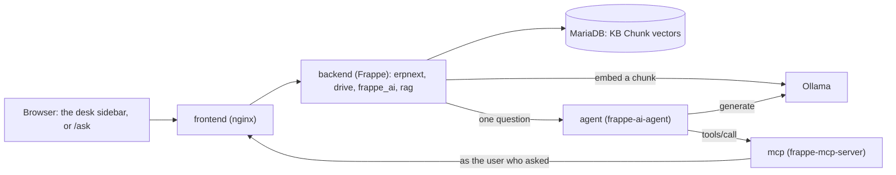

# ragbot

A Docker Compose demo of Frappe, ERPNext and Drive with a knowledge base over your Drive files.

Upload a document to Drive, ask about it in the ERPNext AI sidebar, and the answer is drawn from
that document, limited to the files Drive says you may read.

[](https://github.com/tssarathi/ragbot/actions/workflows/ci.yml)
[](LICENSE)
[](https://github.com/RichardLitt/standard-readme)

Status: a working demonstration on one machine, on `main`, with no releases and no supported
upgrade path. Not a product.

## Table of Contents

- [Security](#security)
- [Background](#background)
- [Install](#install)
- [Usage](#usage)
- [Configuration](#configuration)
- [Local CI](#local-ci)
- [Maintainers](#maintainers)
- [Contributing](#contributing)
- [License](#license)

## Security

Report a vulnerability privately, never in an issue: [SECURITY.md](SECURITY.md) says how, and
what is in scope. [PRIVACY.md](PRIVACY.md) lists every call that leaves a container, what it
carries and what is kept.

## Background

Four services and a browser. Frappe serves ERPNext, Drive and two apps of its own: `rag`, which
indexes Drive files into MariaDB vectors, and `frappe_ai`, which puts the AI sidebar on the desk.
A question goes to the agent, the agent asks the MCP server for its tools, and one of those tools
is `rag`'s own permission-aware search.



Every tool call the agent makes runs as the user who asked, so an answer can only read what Drive
already lets that user read.

## Install

You need Docker Compose 2.24 or newer, because the compose file uses the `!reset` tag. Allow
about 25 GB of disk for the images, and keep port 8080 free.

Both models must already be on the host, and `make up` refuses to start without them. By
default the stack uses the host's own Ollama, which on a Mac runs on the GPU: Docker Desktop
cannot pass the GPU to a container, and on an M4 Max the same model wrote 92 tokens/s natively
against 36 in a container. Keep the Ollama app open, or run `ollama serve`.

```sh
ollama pull gemma4:26b && ollama pull nomic-embed-text
make setup
```

To run Ollama in a container instead, which mounts `~/.ollama/models` read-only, use
`make up OLLAMA=container`, or put `OLLAMA=container` in `.env` to keep it. On Linux, the
host's Ollama must listen beyond loopback for the containers to reach it. `OLLAMA_HOST=0.0.0.0`
does that by publishing an unauthenticated model API, `generate`, `pull` and `delete` included, to
every network the host is on; bind it to the one address the containers use instead, the address
`host.docker.internal` resolves to inside them:

```sh
make shell   # then, in the container:
python3 -c "import socket; print(socket.gethostbyname('host.docker.internal'))"
```

An Ollama on another machine needs TLS and something that authenticates in front of it. Both rag
and the agent speak plain `http` to whatever address they are given, and every chunk of every
document and every question crosses that link: [PRIVACY.md](PRIVACY.md) says exactly what.

`make site` writes that address, and `EMBED_MODEL`, into the site's own configuration as
`rag_ollama_url` and `rag_embed_model`, so each site on a bench indexes against its own Ollama.
Changing `OLLAMA` for a site that already exists means changing the address there as well:

```sh
make bench ARGS="--site demo.localhost set-config rag_ollama_url http://ollama:11434"
```

A site that sets neither key indexes with `nomic-embed-text` at `http://host.docker.internal:11434`.

`AI_MODEL` is a 26B model needing roughly 19 GB of memory while it answers. `AI_NUM_CTX` is the
context window the agent asks Ollama for: 65,536 tokens, Ollama's advice for agents, where the model
takes up to 262,144. A first run takes about twenty minutes, mostly building images.

The agent and MCP images keep their Go, uv and pip downloads in BuildKit cache mounts, so only the
first build pays for them. `docker buildx prune` and `docker system prune` wipe those mounts with the
rest of the build cache; `docker buildx prune --filter 'type!=exec.cachemount'` keeps them, and
`docker buildx du --filter type=exec.cachemount` shows what they hold. `docker build --no-cache`
hands the build an empty mount, so it measures a cold build, not a rebuild.

Sign in at <http://demo.localhost:8080> as `Administrator` with the `ADMIN_PASSWORD` in `.env`. ERPNext is at `/app`,
Drive at `/drive`, and the AI sidebar is the button in the ERPNext navbar.

## Usage

Upload a `.txt` or `.pdf` to Drive and it indexes itself. Then ask about it in the sidebar in
your own words, with no special phrasing: the sidebar reaches the index through a
`search_knowledge_base` tool on the MCP server, the service that gives the agent its tools.

Or open <http://demo.localhost:8080/ask> for Metis, a standalone document chat in the
style of Open WebUI. Sign in with the same account: it asks the same agent, shows only the Drive
files you can read, and lists the passages each answer read as its sources.

The last two use `bench`, Frappe's command line, inside the running container:

```sh
make check                                                              # every gate below
make bench ARGS="--site demo.localhost execute rag.ingest.health"       # is the index sound
make bench ARGS="--site demo.localhost execute rag.ingest.reindex_all"  # rebuild it
```

Restoring a database backup taken without `mariadb-client.cnf` leaves every vector as zeroes,
which `rag.ingest.health` reports and `reindex_all` repairs.

[PRIVACY.md](PRIVACY.md) lists every call that leaves a container, what it carries and what is
kept. [SCALING.md](SCALING.md) lists every ceiling with its number.

## Configuration

| File | Purpose |
| --- | --- |
| `.env` | Ports, passwords and model names, copied from `.env.example` on first run |
| `apps.json` | Frappe apps baked into the image; changing it needs `make destroy && make setup` |
| `rag/` | The knowledge base app, bind-mounted; what a change to it needs is below |
| `rag/frontend/` | The `/ask` app, a static Next.js export served by Frappe; `make ask` rebuilds it |
| `mcp/config.yaml` | MCP server settings, including the session auth that runs each tool call as the caller |
| `mariadb-client.cnf` | Makes database dumps preserve vectors |
| `nginx-realtime-auth.conf` | Lets the realtime service authorise the sidebar's connection |

### Reaching the running stack

`rag/` is bind-mounted, so an edit is on disk in the containers at once. Whether it takes effect is
another matter:

| Changed | What it needs |
| --- | --- |
| a Python module | restart the containers that run it: `backend`, `queue-short`, `queue-long`, `queue-index`, `scheduler` |
| `hooks.py` | that restart, then `make bench ARGS="--site demo.localhost clear-cache"` |
| a DocType's `.json` | `make bench ARGS="--site demo.localhost migrate"`, which syncs the schema and clears the cache; the restart as well only if the DocType's Python class changed, because that is a module |
| `rag/frontend/` | `make ask` |

The two cache lines are not belt and braces. Without `developer_mode` Frappe reads `hooks.py` once
and keeps it in Redis, not in the worker (`frappe.get_hooks`, which takes the `client_cache` branch),
and it keeps each DocType's meta the same way. That cache lives in the `redis-cache` container, which
outlives a `backend` restart, so the old hooks and the old schema answer until something clears it.

### Keys

Every key has a default, so an empty `.env` still runs. `make .env` writes the two passwords.
A Make variable is overridden on the command line (`make up OLLAMA=container`); a compose value is
derived from the others and is changed in `compose.demo.yaml`; a site key is per site and survives
a rebuild. The commands in this README use the default site name.

| Key | Set in | Default | Effect | Production |
| --- | --- | --- | --- | --- |
| `SITE_NAME` | `.env` | `demo.localhost` | The site `make site` creates and every target names | your own domain |
| `HTTP_PUBLISH_PORT` | `.env` | `8080` | Host port, published on `127.0.0.1` only | behind your own proxy |
| `ADMIN_PASSWORD` | `.env` | random | The site's Administrator password | your own secret |
| `DB_PASSWORD` | `.env` | random | MariaDB's root password, read as `DB_ROOT_PASSWORD` | your own secret |
| `CUSTOM_IMAGE`, `CUSTOM_TAG` | `.env` | `frappe-demo`, `16` | Name and tag of the bench image `make image` builds | your own registry |
| `AI_MODEL` | `.env` | `gemma4:26b` | The model the agent answers with; must be on the host | as you choose |
| `AI_NUM_CTX` | `.env` | `65536` | Context window the agent asks Ollama for | as you choose |
| `EMBED_MODEL` | `.env` | `nomic-embed-text` | The indexer's model; must return 768-dimension vectors | must stay 768-dim |
| `OLLAMA` | `.env` | `native` | `native` uses the host's Ollama, `container` runs one in Docker | as you choose |
| `FRAPPE_BRANCH` | Make | `version-16` | The Frappe branch the image is built from | pin it |
| `FRAPPE_PATH` | Make | `https://github.com/frappe/frappe` | The Frappe remote the image is built from; the Makefile fixes it | as is |
| `FRAPPE_DOCKER`, `FRAPPE_DOCKER_REF` | Make | `.build/frappe_docker`, a commit | The frappe_docker clone the compose files come from | pin it |
| `AGENT_GIT`, `AGENT_REF` | Make | the upstream URL, a commit | The `frappe-ai-agent` remote and commit `make agent-image` builds and `make service-suites` tests; docker clones it, so give the full 40-character SHA | pin it |
| `MCP_GIT`, `MCP_REF` | Make | the upstream URL, a commit | The `frappe-mcp-server` remote and commit `make mcp-image` builds and `make service-suites` tests; same | pin it |
| `AGENT_IMAGE`, `MCP_IMAGE` | Make | `frappe-ai-agent:local`, `frappe-mcp-server:local` | Tags those two images are built and run under | your own registry |
| `AGENT_URL` | Make | `http://agent:8484` | What `make site` writes into the site as `frappe_ai_agent_url` | your own address |
| `OLLAMA_URL` | Make | from `OLLAMA` | `http://host.docker.internal:11434` or `http://ollama:11434`; `make site` writes it into the site as `rag_ollama_url` | your own address |
| `BUILD_FLAGS` | Make | empty | Extra flags for every `docker build`, such as `--no-cache` | as needed |
| `SETUP_DEMO` | Make | `1` | Whether the ERPNext setup wizard loads demo data | `0` |
| `COMPOSE_PROJECT` | Make | `frappe-demo` | The compose project, and so the container and volume names | your own |
| `HTTP_PORT`, `DB_ROOT_PASSWORD` | Make | from `.env` | The Makefile's names for the two keys above | set the `.env` keys |
| `TEST_SITE`, `RAG_ONLY_SITE`, `FAI_ONLY_SITE` | Make | `test.localhost`, `rag.localhost`, `fai.localhost` | Sites the system checks and the absence matrix create and change; never the demo | not installed |
| `FRAPPE_SITE_NAME_HEADER` | compose | `SITE_NAME` | Which site the frontend's nginx serves | as is |
| `FRAPPE_BASE_URL` | compose | `http://frontend:8080` | Where the MCP server reaches Frappe | as is |
| `AI_AGENT_FRAPPE_URL`, `AI_AGENT_MCP_SERVER_URL` | compose | `http://frontend:8080`, `http://mcp:8080/mcp` | Where the agent reaches Frappe and its tools | as is |
| `AI_AGENT_CORS_ORIGINS` | compose | the site's own origin | Browser origins the agent answers | your own origin |
| `AI_AGENT_LLM_BASE_URL`, `AI_AGENT_LLM_MODEL`, `AI_AGENT_LLM_NUM_CTX` | compose | `OLLAMA_URL`, `AI_MODEL`, `AI_NUM_CTX` | The agent's model and where it runs | as is |
| `OLLAMA_NOPRUNE` | compose | `1` | Stops the container's Ollama pruning the read-only model mount | as is |
| `DEMO_TREE` | compose | `.` | Which working tree the stack mounts as `rag/` (ADR-017) | a checkout, not a working tree |
| `rag_ollama_url` | site | `http://host.docker.internal:11434` | Where the indexer embeds; each site may differ | your own address |
| `rag_embed_model` | site | `nomic-embed-text` | The indexer's model for this site | must stay 768-dim |
| `rag_status_panel` | site | on | The Status panel on `/ask`; see below | `0` |
| `frappe_ai_agent_url` | site | none | Where Frappe reaches the agent; `make site` writes it | your own address |
| `frappe_ai_agent_url_unsafe_ok` | site | off | Lets that address be a private one, which local development needs | off |

`EMBED_DIM`, `EMBED_TIMEOUT`, `EMBED_BATCH` and `EMBED_BUDGET_S` in `rag/rag/ingest.py`, and
`AGENT_STATE` in `rag/rag/status.py`, look like keys and are not: they are constants, each with its
reason beside it. Change one by editing the file.

`/ask` carries a Status panel, which is the demo's own: where this server runs, what the agent's model
answers at, and what this tab has seen happen. A site switches it off with `rag_status_panel`, which is
on where a site says nothing:

```sh
make bench ARGS="--site demo.localhost set-config rag_status_panel 0"
```

Off, `/ask` draws neither the panel nor its toggle, `rag.status.summary` refuses, and nothing asks the
cloud metadata services where this server runs. The top bar's chip, the model's name and the two
connection toasts are not the panel and stay.

To take the panel out for good rather than switch it off, delete: `rag/frontend/components/StatusPanel.tsx`
and `rag/frontend/public/marks/`; `rag/frontend/lib/activity.ts` with `activity.test.ts`,
`index-states.test.ts` and the `noteIndexing` calls in `Chat.tsx` and `Documents.tsx`, and the `log` line
in `Connection.tsx`; the `--color-pace-*` and `--color-brand-*` variables in `app/globals.css`, light and
dark; `summary()` with its helpers, `location()` and `panel_on()` in `rag/rag/status.py`, with
`test_status_switch.py`, `test_status_probe.py`, `test_status_without_frappe_ai.py` and the panel classes
in `test_status.py`; the `status_panel` key in `rag/rag/www/ask.py` and `lib/frappe.ts`; the `panel`
branch in `App.tsx`; and this paragraph.

## Local CI

`.github/workflows/ci.yml` runs on every pull request and every push to `main`. Each job runs
something you can run here, and nothing you cannot:

| Job | What it runs | The same thing here |
| --- | --- | --- |
| Lint, format and boundaries | every hook in `.pre-commit-config.yaml`: ruff, ruff format, pyrefly, bandit, markdownlint, hadolint, actionlint, zizmor and the import contract | `uvx pre-commit run --all-files` |
| Metis | eslint, prettier, tsc, vitest and the `/ask` build | `cd rag && yarn lint && yarn format:check && yarn typecheck && yarn test && yarn build` |
| rag on a bench | `bench run-tests --app rag` on MariaDB, with drive and frappe_ai fetched at the refs `apps.json` names | `make check`, which runs the same suite on the test site |
| Security | semgrep with frappe's own rules, osv-scanner and gitleaks | the same three commands |
| MCP image | `docker build` of `mcp/Dockerfile`, and an SBOM of what it produced | `make mcp-image` and `make sbom` |

On a pull request, Metis and the bench job run only when `rag/`, `apps.json` or a workflow changed,
and the MCP image job only when `mcp/`, the `Makefile` or a workflow did. Lint and Security read
every file, so they always run, and a push to `main` runs all five whatever it touched.

The end-to-end run stays here: the whole Compose stack, a model answering, and the system checks
under `tests/system/`. A hosted runner has no Ollama and no GPU, so a job that claimed to run it
would prove nothing. `make check` and `make smoke` are that gate and they need the stack up.

[act](https://github.com/nektos/act) runs a job the way GitHub will:

```sh
act pull_request --workflows .github/workflows/ci.yml --job checks
```

## Maintainers

[@tssarathi](https://github.com/tssarathi). [CONTRIBUTING.md](CONTRIBUTING.md) says what a change
needs before it is opened, and [CODE_OF_CONDUCT.md](CODE_OF_CONDUCT.md) applies to everyone taking
part.

## Contributing

[CONTRIBUTING.md](CONTRIBUTING.md) has the whole of it. In short, `make check` must pass: `ruff`
on the host, the frontend and backend tests, the suites of the MCP server and the agent at the
commits this repository pins, the index health check, no new Error Log rows, the search endpoint's
HTTP contract and a dump client that preserves vectors. Commit messages are one-line Conventional
Commits with a scope.

## License

`SPDX-License-Identifier: AGPL-3.0-or-later`, copyright Sarathi Thirumalai Soundararajan. The
notice at the end of [LICENSE](LICENSE) is what this repository grants: version 3 of the licence,
or, at your option, any later one.

ragbot builds on Frappe Drive (AGPL-3.0) and ERPNext (GPL-3.0). The two models are not part of it
and carry their own terms: `gemma4:26b` and `nomic-embed-text` each ship an Apache-2.0 licence
layer, which `ollama show --license <model>` prints.
