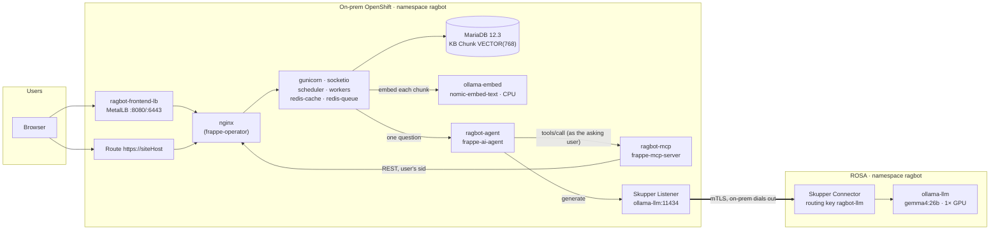

# Architecture

ragbot is an ERPNext and Frappe Drive installation with a knowledge base over the Drive files.
You can ask about a document in the ERPNext AI sidebar, or at `/ask`, and the answer is drawn from
that document. It's limited to the files Drive lets *you* read. This repository runs it across two
OpenShift clusters:

- **On-prem OpenShift** holds the data and everything that touches it: MariaDB, the Frappe tier, the agent and its tools, and the embedding model.
- **ROSA** holds one thing, GPU inference for the chat model.
- **Red Hat Service Interconnect (Skupper)** joins the two at the level of a single service, not the network.

## The picture

## Components

| Component | Runs on | From | Role |
| --- | --- | --- | --- |
| MariaDB 12.3.3 | on-prem | MariaDB Operator (`MariaDB` CR) | Frappe's database. `VECTOR(768)` columns hold the document embeddings (11.7+ required) |
| Frappe bench | on-prem | frappe-operator (`FrappeBench`) | nginx, gunicorn, socketio, scheduler, three workers, two Redis |
| Site | on-prem | frappe-operator (`FrappeSite`, `SiteConfig`) | One tenant with erpnext, drive, frappe_ai and rag installed |
| `rag` app | on-prem, inside the bench | `app/ragbot/rag` | Indexes Drive files into MariaDB vectors, offers a permission-aware search, serves `/ask` |
| `frappe_ai` app | on-prem, inside the bench | vyogotech/frappe_ai | The AI sidebar in the ERPNext desk. Relays a question to the agent |
| ragbot-agent | on-prem | vyogotech/frappe-ai-agent | Runs the LLM tool loop. Asks the MCP server for tools and the LLM for text |
| ragbot-mcp | on-prem | vyogotech/frappe-mcp-server | The tools, including `search_knowledge_base`. Every call runs as the user who asked |
| ollama-embed | on-prem, CPU | `images/ollama-model` + nomic-embed-text | Turns document chunks and questions into vectors |
| ollama-llm | ROSA, 1 GPU | `images/ollama-model` + gemma4:26b | Generates the answers |
| Skupper sites | both | RHSI 2.x (`Site`, `Listener`, `Connector`) | Makes the ROSA model appear on-prem as `ollama-llm:11434` |

## What happens when someone asks a question

1. **Upload.** A user uploads a PDF to Drive. rag's `File.on_update` hook queues an index job. A worker splits the file into chunks, sends each chunk to `ollama-embed`, and writes the vectors to `KB Chunk` in MariaDB. **None of this leaves on-prem.**
2. **Question.** In the sidebar, frappe_ai sends the question and the user's session id to `ragbot-agent`.
3. **Tools.** The agent asks `ragbot-mcp` for its tools, passing the session id. Each tool call goes back into Frappe *as that user*. `search_knowledge_base` embeds the question on-prem, runs a cosine search in MariaDB, and keeps only chunks from files Drive says this user may read.
4. **Generation.** The agent sends the conversation, plus the passages it found, to `http://ollama-llm:11434`. That address is a Skupper Listener. The request crosses the link to ROSA, and the GPU pod streams tokens back the same way.
5. **Answer.** The agent returns the answer, with its sources, to frappe_ai, which shows it in the sidebar.

One question means several model calls (the agent loops: think, call a tool, think again) and
several tool calls. **Only the model calls cross the link.** The tool loop and every database query
stay on-prem.

## What crosses the link, and what doesn't

| Crosses to ROSA | Stays on-prem |
| --- | --- |
| The question, recent conversation turns, the passages retrieved for this question, tool results the agent includes in its prompt | The database and all files |
| Generated tokens (back to on-prem) | All embeddings: every chunk of every document |
| | Sessions, permissions, the tool loop, audit logs |

"The DB stays on-prem" is true, but retrieved passages are in the prompt. If no document text
may leave the site, run the LLM on-prem as well. The chart supports that by pointing
`AI_AGENT_LLM_BASE_URL` at a local Ollama.

## Why it's split this way

- **Frappe sits next to its database.** A Frappe request makes dozens of small queries. Over a WAN, every page would pay that round trip dozens of times.
- **The agent and MCP sit next to Frappe.** The tool loop runs several MCP→Frappe calls per question. Keeping it on-prem means the link carries a handful of model calls, not every tool call.
- **Embeddings run on-prem, on CPU.** nomic-embed-text is small. Running it locally keeps the bulk of the document text (all of it, at index time) off the link.
- **Only the GPU work runs on ROSA.** It's the one component that needs hardware on-prem doesn't have.

## Latency

- **The link costs one round trip per model call**, not per token, because answers stream. With about 20 ms between sites and 3–4 model calls per question, the link adds well under a second.
- **Model load is the real latency risk.** The model is baked into the image (see [IMAGES.md](IMAGES.md)), so startup involves no download. `OLLAMA_KEEP_ALIVE=-1` keeps it in VRAM. A `postStart` hook loads it before the pod reports Ready. `OLLAMA_CONTEXT_LENGTH` equals the agent's `num_ctx`, so the first real request doesn't trigger a reload.
- **Embedding is local.** Neither indexing nor search crosses the link.

## Security model

- **Permissions** are Drive's own. The MCP server runs every tool call with the asking user's session, and rag checks `user_has_permission(file, "read")` on every result.
- **The model API has no auth**, so it's never exposed. ROSA has no Route and no LoadBalancer for it; the only way in is the Skupper Connector, and inter-site traffic is mTLS. On-prem dials out, so on-prem needs no inbound firewall opening.
- **The link token** (AccessGrant/AccessToken) is a credential, so it is never stored in Git.
- **The frontend LoadBalancer is plain HTTP.** Use the Route (edge TLS) for HTTPS, or terminate TLS in front of MetalLB.
- **All pods run under `restricted-v2`**: non-root, no privilege escalation, all capabilities dropped.

## Failure behaviour

| Failure | Effect |
| --- | --- |
| Skupper link down, or the ROSA GPU pod down | AI answers fail with a stated error. ERPNext, Drive, upload and indexing all keep working |
| ollama-embed down | New uploads queue for indexing (rag retries hourly). Search fails until it returns |
| Agent or MCP down | The sidebar and `/ask` fail. The rest of Frappe is unaffected |
| MariaDB down | Everything is down, as for any Frappe site |
